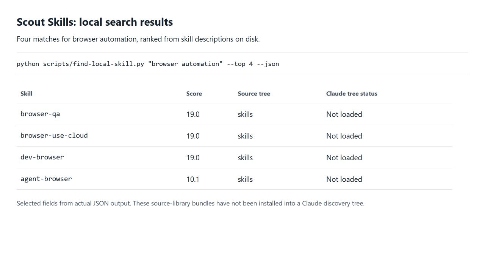
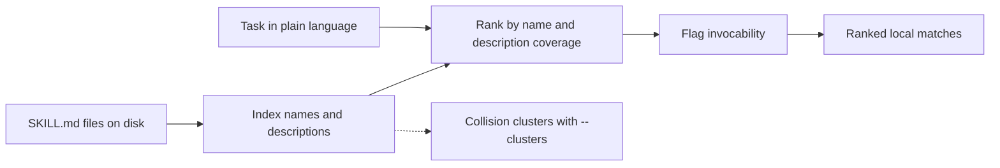

# scout-skills

Find the right local agent skill without loading the whole library into context. Scout Skills combines a Python search and ranking tool with a curated collection of reusable skill bundles for Claude Code, Codex, and Cursor.

## Search example



Selected fields from an actual local JSON search for `browser automation`: skill name, ranking score, source tree and discovery status. The example library has not been installed into a Claude discovery tree; each result reports that status. [Full JSON output](docs/examples/browser-automation.json).

## Paste this into your agent

```text
Set up https://github.com/tdub29/scout-skills for this project and my agent. Read docs/GETTING_STARTED.md, keep a reusable checkout and record its location, install the complete scout-skills bundle using my agent's supported discovery path, preserve existing instructions and local changes, and verify discovery. Use it to find and read every skill contributing concrete guidance to my task, report coverage and gaps, and install only needed complete bundles. Keep search offline. Explain optional Jev setup and bounded-decision routing; enable API calls only within my authorization for spend and data sharing. Never request secrets in chat.
```

This asks your agent to do the setup. It is not a shell command. See
[Getting started](docs/GETTING_STARTED.md) for manual setup, verification and updates.

## Start here

| I want to... | Go to |
|---|---|
| Browse skills by topic | [Category catalog](docs/catalog/README.md) |
| Search the collection from a terminal | [Quick start](#quick-start) |
| Use a skill in a project | [Getting started](docs/GETTING_STARTED.md) |
| Route bounded decisions to optional Jev | [Jev setup and routing](skills/scout-skills/references/jev.md) |
| Find the original publisher or review updates | [Upstream update guide](docs/UPDATING.md) |
| Understand authorship and licenses | [Provenance](PROVENANCE.md) and [third-party notices](THIRD_PARTY_NOTICES.md) |

## Quick start

Python 3 and Git are enough to search the library. No packages, API keys, or network calls are required by the ranker.

```bash
git clone https://github.com/tdub29/scout-skills.git
cd scout-skills
python scripts/find-local-skill.py "browser automation" --top 8
python scripts/find-local-skill.py "options volatility" --json
python scripts/find-local-skill.py "landing page"
```

Open a matching bundle's `SKILL.md`, then follow the [single-skill setup guide](docs/GETTING_STARTED.md). Searching the library does not install or activate a skill.

The [scout-skills bundle](skills/scout-skills/SKILL.md) adds body/reference searches and a
coverage map across contributors. Optional Jev handles repeated typed judgments over supplied
evidence; its bundled Python client supports dry runs and JSONL batches. It requires your own
API key and authorization to send data. Local search works without it.

## How discovery works



Name matches carry more weight than prose mentions. Description terms score on presence, and coverage scales the score. Results report which skill tree contains a match and whether the ranker recognizes it as loaded. [Ranking details and command reference](scripts/README.md).

## Browse the collection

The [category catalog](docs/catalog/README.md) groups every bundle by its primary topic, with a short description, origin label, and recorded upstream source. Categories are navigation aids; the actual bundles stay at `skills/<name>/` so existing links and discovery keep working.

Use the catalog to explore, or search by the task you need to accomplish. Each bundle can contain its own scripts, references, assets, and requirements.

## Repository map

```text
scripts/                  Local ranker and catalog builder
skills/                   Complete skill bundles at stable paths
docs/catalog/             Category index and topic pages
docs/GETTING_STARTED.md    Search and single-skill setup
docs/UPDATING.md           Original publishers, revisions, and updates
provenance.json           Machine-readable origin records
PROVENANCE.md             Per-skill source and authorship evidence
THIRD_PARTY_NOTICES.md    Upstream license and copyright notices
```

## Authorship and upstream work

I maintain the local search/ranking tooling and this collection. Bundles are labeled as imported, adapted, a local creation claim, or unresolved. Local creation claims remain marked unverified; importing or adapting a skill does not transfer its authorship.

Catalog entries link to recorded original sources. A missing source or baseline revision is marked explicitly. Use the [update guide](docs/UPDATING.md) to compare upstream changes while preserving local adaptations and upstream notices.

[Per-skill provenance](PROVENANCE.md) and [machine-readable records](provenance.json) distinguish these origins. Imported and adapted material retains its upstream terms.

## Maintain the catalog

```bash
python scripts/build-catalog.py
python scripts/build-catalog.py --check
python scripts/find-local-skill.py --selftest
python -m unittest discover -s tests
```

[Contributing](CONTRIBUTING.md) covers source records, complete bundles, and catalog maintenance.

## License

[MIT](LICENSE) covers project-owned tooling and original contributions. Imported and adapted skills retain their upstream terms; see [third-party notices](THIRD_PARTY_NOTICES.md).

## More projects

More of my work and contact details are at [twhite.dev](https://twhite.dev).
